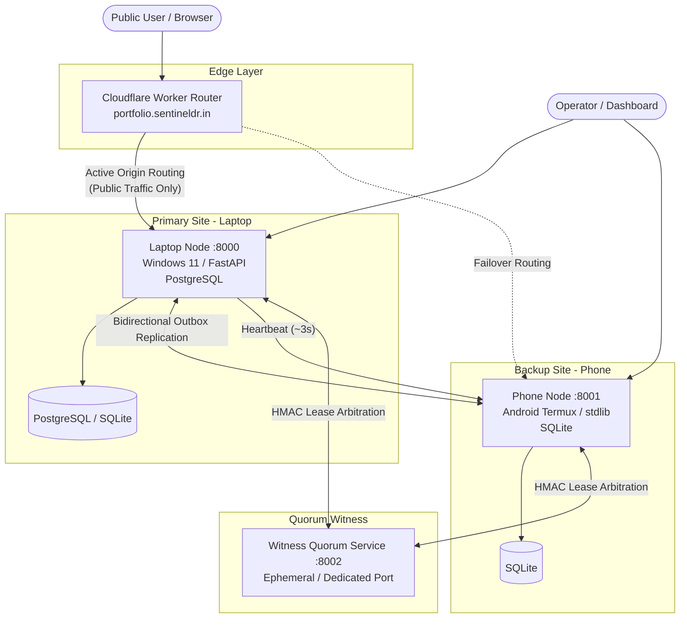
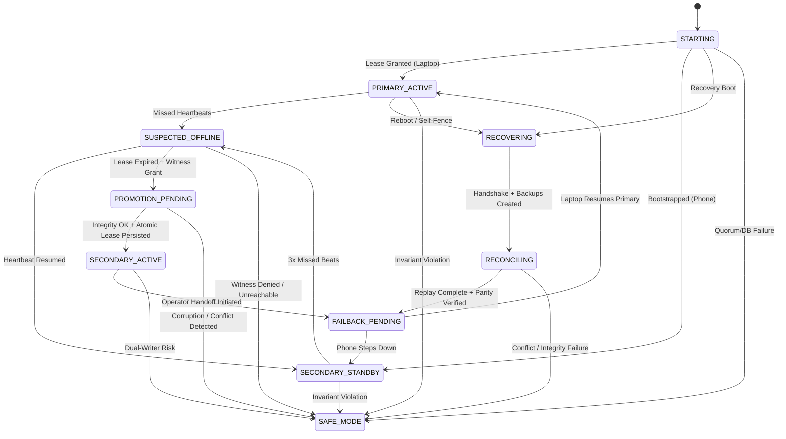
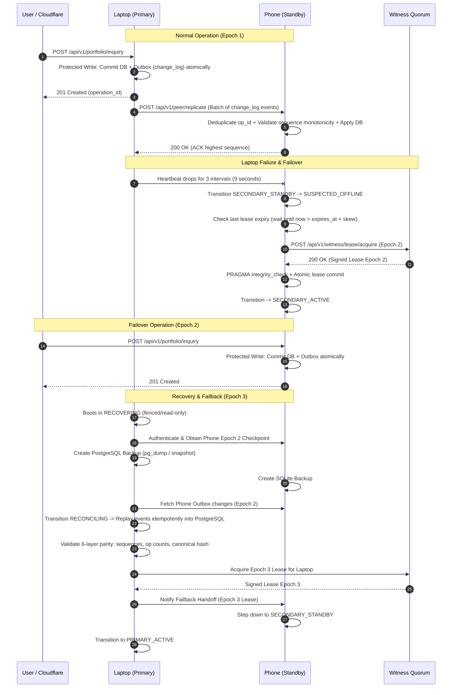

# SentinelDR - System Architecture Document

## 1. System Overview & Philosophy

**SentinelDR** is a resilient, two-node disaster recovery (DR) architecture for a production portfolio web application. It bridges a high-performance Windows development machine (Laptop) and an ultra-low-power, always-on Android smartphone running Termux (Phone), arbitrated by an independent lightweight witness service and fronted by a dynamic Cloudflare Worker edge router.

### Core Philosophy & Invariant Rules
1. **Never Allow Dual Writable Primaries**: Under network partitions, hardware crashes, or clock drift, at most one node is legally permitted to accept user writes. If ownership safety cannot be proven, the system must **fail closed** into read-only `SAFE_MODE`.
2. **Asymmetric Engineering**:
   - **Laptop Node**: Windows 11, Python 3.13+, FastAPI, Pydantic, PostgreSQL (with automatic SQLite development fallback), Port 8000.
   - **Phone Node**: Android Termux, Python Standard Library `http.server` only, SQLite only, Port 8001. Strictly zero third-party dependencies.
3. **No Short-Cut Data Erasure**: Phone-origin writes committed during failover are first-class, durable citizens. Recovery must reconcile them idempotently into PostgreSQL without overwriting or skipping acknowledged changes.
4. **Zero Report-Generation Feature**: SentinelDR is strictly an operational disaster-recovery and portfolio serving platform. Any reporting engine (PDF, CSV, docx, analytics report generation) is an explicit anti-feature and strictly forbidden.

---

## 2. High-Level Topology



---

## 3. Protocol & Security Specifications

### 3.1 Standard Response Envelope
All API endpoints across both nodes return a uniform JSON envelope adhering strictly to the contract defined in `shared/api_contract.py` and `shared/protocol.py`:

```json
{
  "ok": true,
  "data": { ... },
  "error": null,
  "meta": {
    "node_id": "laptop",
    "epoch": 1,
    "timestamp": 1741170000.123
  }
}
```

On error, `"ok": false`, `"data": null`, and `"error"` contains `{ "code": "...", "message": "...", "details": ... }`.

### 3.2 Peer Authentication & Anti-Replay
All peer-to-peer administrative endpoints (`/api/v1/peer/*`) require cryptographic authentication:
- **Headers Required**:
  - `X-SDR-Node`: Sending node identifier (`laptop`, `phone`, or `witness`).
  - `X-SDR-Epoch`: Monotonic cluster epoch.
  - `X-SDR-Timestamp`: Unix epoch timestamp with decimal precision.
  - `X-SDR-Nonce`: 16+ byte hexadecimal random nonce.
  - `X-SDR-Signature`: SHA256 HMAC calculated over:
    `METHOD\nPATH\nTIMESTAMP\nNONCE\nSHA256(BODY)`
- **Persistent Nonce Cache**: Every node maintains a dedicated SQLite table `nonce_cache (nonce, timestamp, node_id, PRIMARY KEY(nonce))` with a 30-second sliding expiration window. Replayed nonces or timestamps outside `now ± 30.0s` are immediately rejected with HTTP 401.

### 3.3 Public Cloudflare Boundary
- Public access to `/api/v1/peer/*` is blocked with HTTP 403 Forbidden at the Cloudflare Worker edge.
- Server-side verification on both nodes strictly requires valid HMAC signatures or Admin Bearer tokens, providing defense-in-depth even if origin ports are directly probed.

---

## 4. State Machine & Ownership Model

The cluster operates under a formal finite state machine defined in `shared/state_machine.py`:



### 4.1 Ownership Records & Bounded Clock Skew
An `OwnershipRecord` comprises:
`cluster_id`, `owner_node_id`, `epoch` (strictly monotonic integer), `lease_id`, `lease_expires_at` (Unix timestamp), `granted_by` (`witness` or peer), and `signature`.

- **Atomic Persistence**: Before any node can transition to a writable role, the new ownership record must be committed to the database in a dedicated transaction.
- **Clock Skew Bounding**: Nodes enforce `max_clock_skew = 2.0s`. If a lease request or write occurs when local clock differs from lease timestamps beyond this bound, the request is rejected.
- **Genuine Write Guards**: Every protected write (such as portfolio inquiries) executes inside a transaction that verifies:
  1. `state_machine.is_writable() == True`
  2. Database lease record is valid, non-expired (`now <= lease_expires_at`), matching current epoch, with `owner_node_id == this_node`.

---

## 5. Replication & Failback Pipeline



---

## 6. Anti-Feature Verification

| Component | Status | Verification Mechanism |
| :--- | :--- | :--- |
| **PDF Reporting** | ABSENT | Codebase grep confirms zero imports of `reportlab`, `fpdf`, `weasyprint`. |
| **CSV Export Engine** | ABSENT | No CSV file generation endpoints exist on either node. |
| **Docx / Office Generators** | ABSENT | No `python-docx` or office libraries present in dependencies or code. |
| **Automated Report Schedulers** | ABSENT | Background tasks are strictly limited to heartbeat and outbox replication. |
