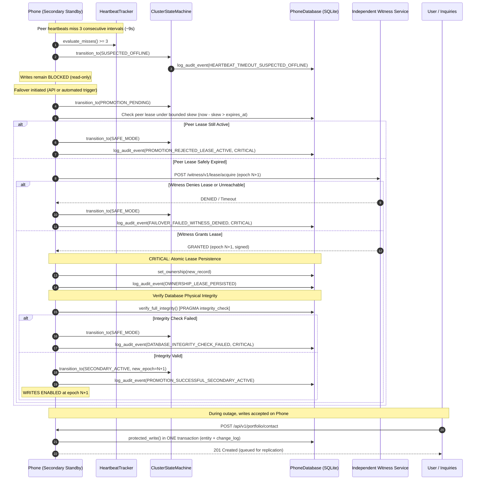

# SentinelDR - Failover Specification & Protocol

## 1. Overview & Core Invariants

SentinelDR enforces a strict disaster recovery invariant: **never allow two writable primaries (zero dual-writer / split-brain tolerance)**.

When the Primary node (Laptop) experiences network disruption, hardware fault, or ungraceful shutdown, the Secondary node (Phone) can only assume active write leadership under mathematically sound, strongly authenticated, and verified conditions.

---

## 2. Failure Detection vs. Promotion Independence

### 2.1 The Three-Beat Rule
- Heartbeats are transmitted between peers every **~3 seconds**.
- The receiving node tracks peer heartbeat arrival using **its own local monotonic clock**.
- After **three consecutive missed heartbeats (3 × ~3s = ~9s)**, the state machine transitions:
  $$\text{SECONDARY\_STANDBY} \longrightarrow \text{SUSPECTED\_OFFLINE}$$

### 2.2 Crucial Invariant: Failure Detection Alone Must NOT Promote
- Entering `SUSPECTED_OFFLINE` **strictly does not promote** the node or enable writes.
- In `SUSPECTED_OFFLINE`, write guards remain fully armed:
  - `is_writable()` returns `False`.
  - All write attempts to `/api/v1/portfolio/*` or `protected_write()` return `403 FORBIDDEN`.
  - Outbox row generation is disabled.
- Failure detection only indicates that peer health is suspect; it does **not** prove that the peer has halted or that a network partition has not occurred.

---

## 3. Promotion Timing & Why Promotion Time Can Exceed 9 Seconds

A common misconception in two-node distributed systems is assuming failover completes immediately after failure detection (9 seconds).

In SentinelDR, **actual promotion time can exceed 9 seconds** due to lease expiry and clock-skew fencing:

1. **Active Primary Lease Window**:
   - The primary node holds a time-bounded lease granted by the Independent Witness (e.g., duration $T_{\text{lease}} = 30\text{s}$).
   - Even if the secondary stops receiving heartbeats at $t = 9\text{s}$, the primary might still be executing writes against an unexpired lease.
2. **Bounded Clock-Skew Fencing ($\Delta_{\text{skew}} \le 2.0\text{s}$)**:
   - Clocks across separate physical devices (Laptop vs. Android Phone) drift. SentinelDR enforces a maximum skew bound $\Delta_{\text{skew}}$.
   - A promotion candidate cannot acquire a lease until:
     $$t_{\text{now}} - \Delta_{\text{skew}} > T_{\text{lease\_expires\_at}}$$
     Equivalently, the candidate must wait until even the slowest conceivable clock has safely surpassed the peer's lease expiration time.
3. **Witness Quorum Verification**:
   - The Independent Witness service verifies lease expiration before issuing an incremented epoch $N+1$.
   - Any attempt to promote while the prior owner's lease is active is rejected with `409 Conflict`.

Thus, total time to promotion is:
$$T_{\text{failover}} = \max(3 \times T_{\text{hb\_interval}}, T_{\text{lease\_remaining}} + \Delta_{\text{skew}}) + T_{\text{witness\_rtt}} + T_{\text{integrity\_check}}$$

---

## 4. Promotion Workflow & Sequence

---

## 5. Fail-Closed Behavior (`SAFE_MODE`)

If at any point safe ownership cannot be irrefutably verified:
1. The node enters `SAFE_MODE`.
2. All data writes remain strictly forbidden (`is_writable() == False`).
3. Critical audit alert is logged to `audit_events`.
4. The system remains fully operational in read-only mode to serve cached portfolio assets, profile, and project information.

Scenarios triggering `SAFE_MODE`:
- Network partition where the Witness is unreachable.
- Peer's lease has not expired under bounded clock-skew calculations.
- Witness denies the lease (e.g. peer renewed first).
- Database physical corruption detected during `verify_full_integrity()` (`PRAGMA integrity_check`).
- Ownership lease write to local database fails.

---

## 6. Strong Authentication for Peer Endpoints

The failover endpoint `POST /api/v1/peer/failover` is strictly non-public. It accepts requests only from:
1. **Admin Key Authentication**: Headers containing valid `X-SDR-Admin-Key` matching `SDR_ADMIN_KEY`.
2. **Signed Peer HMAC-SHA256**: Canonical request signature verified in constant time with `X-SDR-Signature`, timestamp freshness within window, and nonce replay cache.
