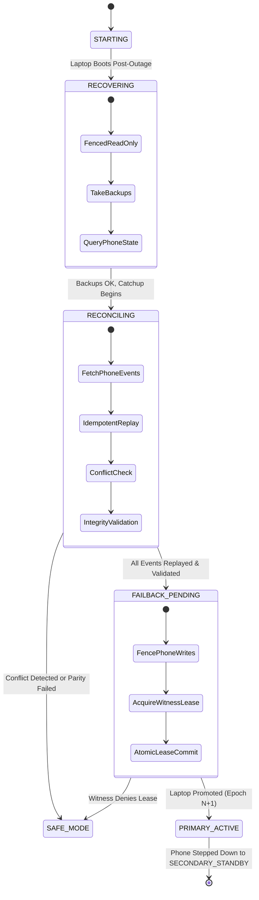

# SentinelDR - Recovery & Failback Specification (Phase 7)

## 1. Overview & Core Invariants

The primary objective of Phase 7 is to return the Laptop node to the `PRIMARY_ACTIVE` role after an outage **without losing or duplicating any acknowledged Phone write**, and without ever erasing Phone-side changes as a shortcut.

### Core Rules & Invariants:
1. **Never Allow Two Writable Primaries**: At no point during recovery, catch-up, or failback may both nodes be writable.
2. **Never Overwrite or Discard Phone Data**: Phone writes committed during the outage are durable and must reach the Laptop exactly once.
3. **Fail-Closed on Unresolved Conflict**: If divergent writes are detected between nodes, automatic failback halts immediately; divergent writes are preserved in `conflict_records` for explicit resolution.
4. **Zero Data Loss via Point-in-Time Backups**: Both databases are backed up consistently before reconciliation.
5. **Durable Restartability**: Recovery progress is tracked via durable checkpoints (`replication_checkpoint`); interrupted recoveries resume without duplication or gaps.

---

## 2. Recovery & Failback Lifecycle State Machine

---

## 3. Step-by-Step Recovery & Failback Protocol

### Stage 1: Fenced Startup (`STATE_RECOVERING`)
- Laptop starts in `STATE_RECOVERING`.
- `is_writable()` returns `False`.
- Protected writes to `/api/v1/portfolio/*` are rejected with `403 FORBIDDEN`.
- Endpoint `POST /api/v1/peer/recovery/start` initiates the session:
  - Takes a consistent online backup of Laptop database (`laptop_db.create_database_backup()`).
  - Prunes backups older than the retention window (`prune_backups()`).
  - Sends authenticated request to Phone: `POST /api/v1/peer/recovery/start`.
  - Phone captures its own point-in-time backup (`phone_db.create_database_backup()`) and returns its current epoch, role, and checkpoints.

### Stage 2: Catch-Up & Idempotent Replay (`STATE_RECONCILING`)
- Laptop transitions to `STATE_RECONCILING`.
- Reads `replication_checkpoint` for origin node `"phone"` (`last_applied_sequence`).
- Fetches batches of unreplicated events from Phone (`GET /api/v1/peer/changes?from_sequence=...`).
- Applies each batch inside a single atomic database transaction via `apply_replication_batch()`:
  - Sequence continuity check (`detect_sequence_gap`).
  - Deduplication by `operation_id` (already-applied events are skipped without re-executing data changes).
  - Outbox row and entity mutation committed together.
  - Advances `replication_checkpoint.last_applied_sequence` atomically.

### Stage 3: Conflict Policy & Divergent Write Preservation
- If an entity modification in the incoming batch conflicts with an existing record modified independently:
  - The conflicting states (both `local_data` and `remote_data`) are preserved in `conflict_records`.
  - Automatic failback is **strictly halted**.
  - Laptop transitions to `STATE_SAFE_MODE` or stays in `STATE_RECONCILING` and raises a `CRITICAL` audit event.
  - The conflict is surfaced via `/api/v1/events` for explicit resolution.

### Stage 4: Multi-Layer Integrity Validation
Before failback can proceed, the following 6 integrity checks must pass:
1. **Physical Integrity**: Complete database constraint and page check (`PRAGMA integrity_check` / PostgreSQL schema check).
2. **Sequence Parity**: Laptop's `last_applied_sequence` matches Phone's highest sequence number.
3. **Entity Count Parity**: Count of portfolio entities on Laptop is $\ge$ count on Phone.
4. **Canonical Data Hash**: SHA256 of sorted entity rows matches between nodes.
5. **Non-Primary Fence Verification**: Confirms Laptop write guards are disarmed.
6. **Read Readiness**: Verifies read queries succeed.

### Stage 5: Controlled Handoff (`STATE_FAILBACK_PENDING`)
- Endpoint `POST /api/v1/peer/failback`:
  1. **Fence Phone Writes**: Laptop calls Phone `POST /api/v1/peer/failback` (`action="fence"`). Phone transitions to `STATE_FAILBACK_PENDING` (`is_writable() == False`).
  2. **Acquire Monotonic Lease**: Laptop calls Independent Witness for epoch $N+1$ (e.g. epoch 3). Witness verifies Phone is fenced/expired and grants lease for Laptop.
  3. **Atomic Persistence**: Laptop saves the new `OwnershipRecord` to database **before** enabling writes.
  4. **Promote Laptop**: Laptop transitions to `STATE_PRIMARY_ACTIVE` (epoch 3). Writes are now enabled on Laptop.
  5. **Step Down Phone**: Laptop notifies Phone `POST /api/v1/peer/failback` (`action="finalize"`). Phone saves epoch 3 lease and transitions to `STATE_SECONDARY_STANDBY`.
  6. **Single Writer Verified**: Exactly one writer exists (`Laptop == PRIMARY_ACTIVE`, `Phone == SECONDARY_STANDBY`).
